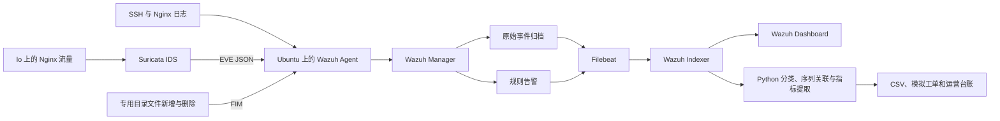
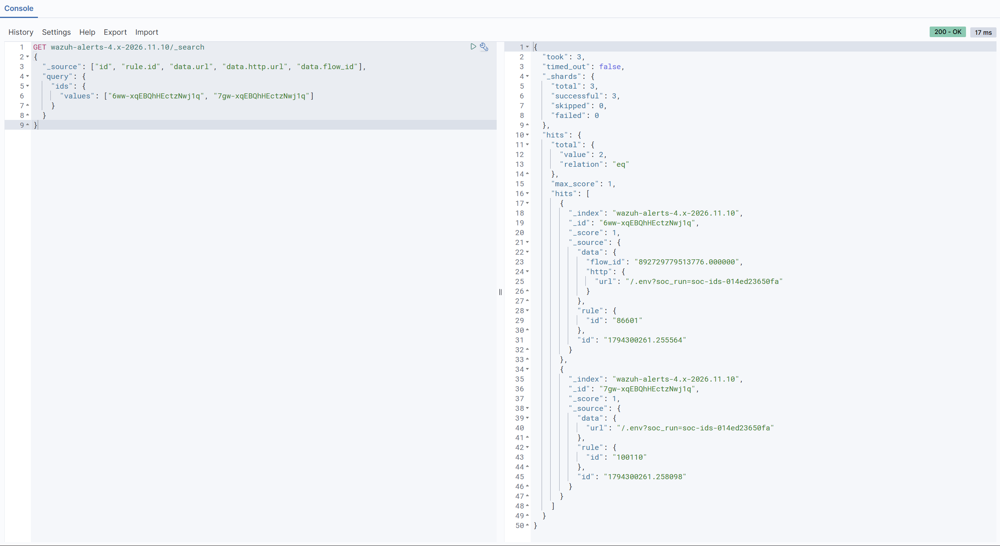

# Wazuh Linux / Web 安全日志监测实验

这是我学习 SOC 安全运营时做的一个本地实验项目。我从 SSH 和 Nginx 日志入手，逐步验证日志如何被采集、触发告警，以及怎样用原始证据支持研判。遇到规则误报或日志链路中断时，我把排查过程和复测结果一起记下来，方便日后回顾，也检验自己对这些环节的理解。

截至 2026 年 11 月 10 日，已验证日志链路、自定义规则与误报调优，并完成 Python 统计、模拟工单、Excel 台账和运营周报。SSH 序列和 Suricata 双源取证已复测。威胁情报完成本地验收，FIM 文件新增与清理均有真实告警，外部 API 待密钥联调。11 月 8 日批次的两份工单仍待关闭复核。

## 环境与链路

Windows 宿主机运行 VMware Ubuntu Server 22.04。虚拟机分配 4 vCPU、8 GiB 内存和 50 GiB 按需增长磁盘。Wazuh 4.14.9 的 Manager、Indexer 和 Dashboard 使用 Docker Compose 部署，Agent 安装在 Ubuntu 本机。Nginx 监听本机回环地址，Windows 通过 SSH 转发访问 Dashboard。



## 验证结果

以下数字来自 2026 年 11 月 8 日最终复测批次，统计覆盖该批次保留的查询结果。

| 结果 | 实测值 |
| --- | ---: |
| 归档记录 | 17 条 |
| SSH 无效用户告警 `5710` | 6 条 |
| 普通 Web 4xx 告警 `31101` | 3 条 |
| 自定义敏感路径告警 `100110` | 1 条 |
| 告警合计 | 10 条 |
| 模拟工单 | 2 份，均待关闭复核 |

最终批次的 6 次本机 SSH 无效用户名连接均留下对应的 `Invalid user` 日志。Web 批次包含 5 个对照请求，只有 `/.env` 返回 404 的正例命中自定义规则 `100110`。四个负例均未命中该规则，部分普通 404 仍触发原生规则。HTTP 404 说明本次请求未找到目标资源，项目验证范围为日志检测和研判。

调优前，规则按 `.env` 子串匹配，导致 `/docs/.env-guide` 等对照也被提升。调优后，规则要求准确匹配 `/.env` 路径并返回 HTTP 404。保留了正例命中，也保留了原生普通 404 分类。规则源码与实测记录见 [规则 XML](config/rules/soc_web_rules.xml)、[回放矩阵](evidence/detection/replay-matrix.json)和[验证摘要](evidence/detection/verification.json)。

Manager 容器重建后曾出现 Filebeat 归档转发恢复为关闭的问题。保留原始备份并挂载 Filebeat 启动脚本，使用 `-M wazuh.archives.enabled=true` 后，再以真实请求验证归档和告警查询。排查过程、规则配置及恢复方法见[检测与研判记录](docs/04-detection-and-triage.md)。

11 月 10 日另行验证 SSH 序列。首轮用 8 条真实认证事件复跑，按主机、来源和目标账户关联后得到 1 条研判结果。另一账号的成功登录未被串联，替换测试公钥后完成了旧密钥被拒与新密钥成功的复测。见 [序列研判与复现](docs/08-ssh-sequence.md) 和 [已关闭的模拟工单](output/tickets/LAB-20261110-SSH-SEQ-001.md)。

Suricata 在同一 Ubuntu 上监听 `lo` 的 TCP 8080。四个请求中只有 `/.env` 触发 IDS 以及 Nginx 自定义规则；同一请求可追溯到 EVE、Nginx 404 和 Wazuh 的两条告警。EVE 轮转后复验通过。见 [Suricata 双源取证](docs/09-suricata.md)。



截图中两条告警的请求标记均为 `soc-ids-014ed23650fa`。右上角的 `200 - OK` 是索引查询成功，Nginx 请求本身返回的 `404` 见[首轮索引证据](evidence/detection/suricata-live.json)。

## 离线复跑

在项目根目录执行，使用 Python 3.10 及以上版本的标准库即可。下列命令读取随仓库提供的脱敏证据。

```powershell
python scripts/test-alert-analysis.py
python scripts/test-ssh-sequence.py
python scripts/test-threat-intel.py
python scripts/analyze-alerts.py --input evidence/detection/public-snapshot.json --output output/reproduced
python scripts/ssh_sequence.py --input evidence/detection/ssh-sequence-repeat.json
python scripts/threat_intel.py --input evidence/detection/ssh-sequence-live.json --input evidence/detection/suricata-live.json --input evidence/detection/threat-intel-fim.json --output output/reproduced/threat-intel.json
```

预期为 21 项测试通过，基础统计为 17 条归档与 10 条告警，SSH 复跑关联出 1 条同账号序列。离线情报报告处理 12 条告警，其中 9 条回环来源跳过、2 条无适用指标、1 条 SHA-256 待在线查询。各批次分别统计。

公开快照取自真实索引查询，仅保留统计、时间和证据关联所需字段。脚本按索引名和文档 ID 去重，分别统计归档和告警。复跑 CSV 与原实验导出内容一致，来源摘要里的 SHA-256 会随输入脱敏而变化。实验部署和在线查询见[复现说明](docs/07-reproduce.md)。

## 项目交付材料

| 内容 | 入口 |
| --- | --- |
| 实验环境与部署记录 | [环境检查](docs/01-environment-and-plan.md)、[部署](docs/02-deployment.md) |
| 日志链路与实际查询 | [链路记录](docs/03-extension-status.md)、[脱敏证据](evidence/pipeline/verification.json) |
| 两类事件、规则与误报分析 | [检测与研判](docs/04-detection-and-triage.md) |
| Suricata 回环 IDS | [配置与研判](docs/09-suricata.md)、[脱敏证据](evidence/detection/suricata-live.json) |
| 威胁情报与 FIM | [本地验收](docs/10-threat-intel.md)、[FIM 工单](output/tickets/LAB-20261110-FIM-001.md) |
| Python 分类与 CSV | [统计说明](docs/05-python-csv-analysis.md)、[分组统计](output/operations/alert-statistics.csv) |
| 模拟工单 | [SSH](output/tickets/LAB-20261108-SSH-001.md)、[Web](output/tickets/LAB-20261108-WEB-001.md) |
| 台账和周报 | [Excel 台账](outputs/01a1abcb-32ee-7f01-b558-253dcc8dafce/SOC-运营台账-2026-11-10.xlsx)、[Markdown 周报](outputs/01a1abcb-32ee-7f01-b558-253dcc8dafce/SOC-运营周报-2026-11-10.md) |
| 阶段博客 | [从日志采集到告警研判](output/blog/wazuh-soc-progress-2026-11-08.md) |
| 作品集交付 | [演示顺序、简历文案和 Git 发布检查](docs/11-portfolio.md) |

## 后续范围

告警通知暂缓。威胁情报已验收本地提取、过滤、缓存和错误路径，在线查询待 API 密钥。pfSense、TheHive/Cortex、Microsoft 365 和品牌定制按资源与账号条件评估。
